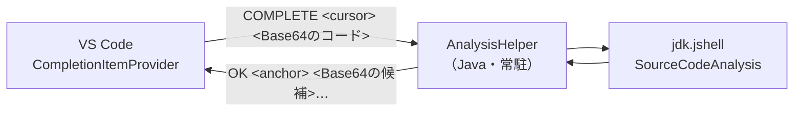

# プログラム設計書：入力補完（src/completion.ts、src/analysisHelper.ts、src/java/AnalysisHelper.java）

## 1. 概要
Java コードの入力中に候補を表示する機能。`System.` と入力すると `out` や `err` が候補に出る。

同梱している JDK の **JShell 解析API（`jdk.jshell` の `SourceCodeAnalysis`）** を利用する。
これは JShell の Tab 補完と同じ仕組みで、外部の言語サーバーや別途の JDK は不要。

解析は Java のヘルパープロセスが担当し、VS Code 拡張機能とは標準入出力でやり取りする。
補完のたびに JVM を起動すると実用に耐えないため、**ヘルパーは常駐させる**。

v1.3.1 で、**カーソルより前の宣言を JShell へ登録してから補完する**ようにした。
それまではファイル内の宣言を登録していなかったため、`test.` のように自分で定義したクラスのメンバーが候補に出なかった
（`String s = "abc";` → `s.` のように、標準クラスの変数だけは解析で補えていた）。

## 2. 基本情報
| 項目 | 内容 |
|------|------|
| 実装ファイル | `src/completion.ts`（補完の処理）／`src/analysisHelper.ts`（ヘルパーのプロセス管理。エラーチェックと共用）／`src/java/AnalysisHelper.java`（Java側） |
| 配置 | ヘルパーのソースはビルド時に `dist/tools/AnalysisHelper.java` へ複製する（`scripts/copy-tools.js`） |
| 実行方法 | 単一ファイルソースコードランチャー（`java AnalysisHelper.java`）。事前コンパイル不要 |
| 有効化 | `activationEvents: ["onLanguage:java"]` |
| 設定 | `JavaCodeSelectionRunner.enable_completion`（既定 `true`） |

## 3. 構成

## 4. 通信プロトコル

1行1リクエスト・1行1レスポンスのテキストプロトコル。
改行や空白を含むコードを1行で安全に送るため、**コードと候補は Base64（UTF-8）で符号化**する。

| 要求 | 応答 |
|------|------|
| `COMPLETE <カーソル位置> <Base64のコード> <Base64の便利メソッド>` | `OK <アンカー位置> <Base64の候補1> <Base64の候補2> …` |
| （同上・失敗時） | `ERR <Base64のエラーメッセージ>` |
| `PING` | `PONG` |
| `QUIT` | 応答なし（プロセス終了） |

**アンカー位置**とは、候補で置き換えられる範囲の開始位置。
例えば `System.ou` の状態なら、アンカーは `ou` の開始位置を指す。

## 5. 実装詳細（VS Code側：completion.ts）

### 5.1 registerCompletion
| 項目 | 内容 |
|------|------|
| 登録 | `vscode.languages.registerCompletionItemProvider('java', provider, '.')` |
| トリガー文字 | `.`（ドットを入力した時点でも候補を出す） |
| 後始末 | プロバイダとヘルパーを `context.subscriptions` へ登録する |

### 5.2 provideCompletionItems
| 手順 | 内容 |
|------|------|
| 1 | 設定 `enable_completion` が false なら何も返さない |
| 2 | カーソル位置までのテキストを解析対象とする |
| 3 | 20,000文字を超える場合は、カーソル手前の一定量だけを行の先頭に合わせて切り出す |
| 4 | `CancellationToken` を確認し、取り消されていれば中断する |
| 5 | ヘルパーへ問い合わせる（応答後にも取り消しを確認する） |
| 6 | 切り出した分だけアンカー位置を元の位置へ戻す |
| 7 | アンカー位置からカーソル位置までを置き換え範囲として `CompletionItem` を組み立てる |

**置き換え範囲の制約**：VS Code の API 仕様では、補完の `range` は
「単一行であること」かつ「補完要求が行われた位置を含むこと」が求められる
（`vscode.d.ts` の `CompletionItem.range` の記述）。
そのため、アンカー位置が前の行に及ぶ場合に備えて、**開始位置をカーソル行の先頭までに制限**している。

候補の種類（アイコン）は文字列から推測する。

| 条件 | 種類 |
|------|------|
| `(` で終わる | メソッド |
| 大文字で始まる | クラス |
| それ以外 | フィールド |

### 5.3 AnalysisHelper クラス（プロセス管理：src/analysisHelper.ts）

v1.3.0 でエラーチェック（[diagnostics.md](diagnostics.md)）と共用するため、`completion.ts` から `analysisHelper.ts` へ移した。
インスタンスは `extension.ts` の `activate()` で1つだけ生成し、補完とエラーチェックへ渡す。

| 項目 | 内容 |
|------|------|
| 起動 | 初回の要求時（補完またはエラーチェック）に `cp.spawn` で起動する（遅延起動） |
| 起動コマンド | `<javaHome>/bin/java --add-modules jdk.jshell -Dfile.encoding=UTF-8 <dist/tools/AnalysisHelper.java>` |
| 直列化 | 要求が重ならないよう、`requestQueue` で1件ずつ処理する |
| 古い要求の破棄 | 送信前に、同じ種類（key）の要求の中で自分が最新かを確認し、入力が続いている場合は送らずに捨てる。key は補完が `complete`、エラーチェックが `check:<ファイルのURI>`（種類が違う要求同士では破棄しない） |
| 標準エラー出力 | **読み捨てずに受け取る**（読まないとパイプが詰まってヘルパーが停止するため）。起動失敗時は最初の1回だけ警告として通知する |
| 応答行の判定 | `OK` / `ERR` / `PONG` で始まる行だけを応答として扱う（JVMの警告などが混ざっても取り違えないようにするため） |
| タイムアウト | 要求ごとに指定する（補完は5秒、エラーチェックは15秒）。応答が無ければ失敗扱いとし、プロセスを停止する（次回の要求で再起動される） |
| 異常終了 | `exit` / `error` を検知したら参照を破棄し、次回に再起動する |
| 利用不可の判定 | ヘルパーのソースが無い、Java が使えない場合は `isUnavailable` を立てて以降は試行しない |
| 終了処理 | `dispose()` で `QUIT` を送ってからプロセスを終了する |

出力は `\n` 区切りで1行ずつ組み立てる（`receive()`）。

## 6. 実装詳細（Java側：AnalysisHelper.java の COMPLETE）

エラーチェック（`CHECK`）の実装は [diagnostics.md](diagnostics.md) を参照。

| 項目 | 内容 |
|------|------|
| 入出力 | UTF-8 固定（`InputStreamReader` / `PrintStream` に明示） |
| 要求の形式 | `COMPLETE <カーソル位置> <Base64のコード> <Base64の便利メソッド>`（便利メソッドは v1.3.1 で追加。省略時は読み込まない） |
| JShell の生成 | エラーチェックと同じ**コードを実行しないエンジン**（`createNoExecutionShell()`。[diagnostics.md](diagnostics.md) の 6.1）。v1.3.0 までは `executionEngine("local")` だったが、宣言を `eval` するようになったため変更した |
| スニペットの切り出し | `splitCompleteSnippets()`：`analyzeCompletion()` でカーソルより前の完結したスニペットを切り出す。後ろに何も続かないもの（入力中のもの）、文法エラー（UNKNOWN）、途中で終わっているものに当たったら、そこからカーソルまでを「補完対象のスニペット」とする |
| 宣言の登録 | `getCompletionShell()`：DEFAULT の import、便利メソッド、切り出したスニペットを順に `eval` する（**実行はしない**） |
| 登録の使い回し | 便利メソッドと切り出したスニペットの内容が前回と同じなら、前回の JShell をそのまま使う。同じ文の入力中は登録し直さないため、大きなファイルでも2回目以降は速い |
| 補完の取得 | `completionSuggestions(補完対象のスニペット, 末尾, anchor)`。アンカー位置にスニペットの開始位置を足して、元のコード上の位置へ戻す |
| 候補が空の場合 | **カーソル行だけを対象にして再試行する**（クラス定義の途中など、スニペット全体では解析できない場合の保険）。アンカー位置は元のコード上の位置へ補正する |
| 重複の除去 | `LinkedHashSet` で順序を保ったまま重複を除く |
| 例外 | 捕捉して `ERR <Base64>` を返す。プロセスは終了しない |

## 7. 制限事項
- JShell は「スニペット単位」の解析を行うため、**クラス定義の内部（メソッドの中など）での補完は限定的**。
  候補が出ない場合はカーソル行のみを解析するため、同じメソッド内で宣言した変数のメンバーは候補に出ないことがある。
- 宣言の登録をやり直す場合（カーソルより前を編集した直後）は時間がかかる。数十行で0.05秒程度、420行で1秒程度（2回目以降は0.03秒程度）。
- 初回の補完時にヘルパーを起動する。単一ファイルソースコードランチャーは実行時にコンパイルするため、
  **初回のみ数秒かかる**。以降は常駐プロセスが応答する。
- VS Code を開いている間、Java のプロセスが1つ常駐する（エラーチェックと共用）。
- エラーチェックと同じプロセスで直列に処理するため、大きなファイルのチェック中（数百行で0.7秒程度）は補完の応答が待たされる。
- 解析対象は最大20,000文字。これを超えるファイルでは、カーソル手前の範囲だけを解析する。

## 8. 今後の改善余地
- `SourceCodeAnalysis.documentation()` を使ってホバー表示やシグネチャヘルプを追加できる。
- ヘルパーを事前コンパイルして `.jar` として同梱すれば、初回の待ち時間を短縮できる。
- 整形処理（現在は都度 JVM を起動）を同じヘルパープロセスへ相乗りさせれば、整形も高速化できる。
- クラス定義内での補完精度を上げるには、カーソル位置を含むメソッド本体を抽出して解析する等の工夫が必要。
- 宣言の登録をやり直す際、変更のあったスニペット以降だけを登録し直せば、大きなファイルでも速くできる。
