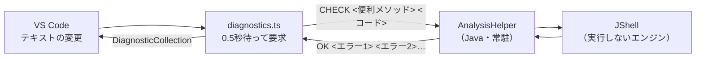

# プログラム設計書：エラーチェック（src/diagnostics.ts、src/java/AnalysisHelper.java）

## 1. 概要
Java コードの入力中に、コンパイルエラーの箇所へ赤い波線を表示する機能（Eclipse のエラー表示に相当）。

```java
Test test = new Test(1111);   // ← 赤線「不適合な型: intをjava.lang.Stringに変換できません」
```

入力補完と同じく、同梱 JDK の **JShell（`jdk.jshell`）** を使う。外部の言語サーバーや別途の JDK は不要。
チェックは補完と共用の常駐ヘルパー（`AnalysisHelper`）が行う。

**コードはコンパイルするだけで、実行しない。**
実行すると、入力待ち（`input()`）・無限ループ・`System.exit()`・ファイル操作などが、編集中に勝手に動いてしまうため。

- 追加バージョン：v1.3.0（2026-09-28）
- メッセージの言語：日本語（JDK の javac が持つ日本語メッセージを使用）

## 2. 基本情報
| 項目 | 内容 |
|------|------|
| 実装ファイル | `src/diagnostics.ts`（VS Code側）／`src/java/AnalysisHelper.java`（Java側・`CHECK` 要求）／`src/sourceText.ts`（実行と共用するコード） |
| プロセス管理 | `src/analysisHelper.ts`（補完と共用。[completion.md](completion.md) の 5.3 を参照） |
| 有効化 | `activationEvents: ["onLanguage:java"]` |
| 設定 | `JavaCodeSelectionRunner.enable_diagnostics`（既定 `true`） |
| 表示 | `vscode.languages.createDiagnosticCollection` による赤線と「問題」パネル（出どころ：`JShell`） |

## 3. 構成



## 4. 通信プロトコル
補完と同じ1行1リクエスト・1行1レスポンス。文字列は Base64（UTF-8）で符号化する。

| 要求 | 応答 |
|------|------|
| `CHECK <Base64の便利メソッド> <Base64のコード>` | `OK <Base64のエラー1> <Base64のエラー2> …`（エラーが無ければ `OK` のみ） |
| （同上・失敗時） | `ERR <Base64のエラーメッセージ>` |

エラー1件は `開始位置<TAB>終了位置<TAB>E または W<TAB>メッセージ` の形式。
位置は送ったコードの先頭からの文字数（UTF-16 の文字単位。VS Code の `offsetAt` と同じ数え方）。

## 5. 実装詳細（VS Code側：diagnostics.ts）

### 5.1 registerDiagnostics
| きっかけ | 処理 |
|----------|------|
| 起動時に開いているファイル／ファイルを開いた | すぐにチェックする |
| テキストの変更 | **0.5秒待ってから**チェックする。待っている間に再度入力があれば予約し直す |
| ファイルを閉じた | 予約を取り消し、表示を消す |
| 設定 `enable_diagnostics` の変更 | 開いているファイルをチェックし直す（無効なら表示を消す） |

対象は言語が `java` で、スキームが `file` または `untitled` のもの（git の差分表示などは対象外）。

### 5.2 checkDocument
| 手順 | 内容 |
|------|------|
| 1 | 設定が無効、または100,000文字を超える場合は表示を消して終わる |
| 2 | **実行時と同じく全角スペースを半角へ置き換える**（`replaceFullWidthSpace`。1文字を1文字へ置き換えるため位置はずれない） |
| 3 | 便利メソッドのコードとともに `CHECK` を送る（key は `check:<URI>`、タイムアウト15秒） |
| 4 | 応答が無い、または送信後にファイルが閉じられた・編集された場合は表示を更新しない |
| 5 | エラーを `vscode.Diagnostic` にして表示する（`E` はエラー、`W` は警告） |

**幅0のエラーの扱い**：「';'がありません」のように位置だけを持つエラーは、そのままでは線が見えにくい。
次の1文字（行末の場合は直前の1文字）に広げて表示する。

### 5.3 実行と共用するコード（sourceText.ts）
判定を実行時と食い違わせないため、次の2つを `extension.ts` から切り出し、実行とエラーチェックで共用する。

| 関数 | 内容 |
|------|------|
| `buildHelperMethods(inputCharset, eol)` | 実行時に定義する便利メソッド（`input()`、`inputToInt()` など） |
| `replaceFullWidthSpace(code)` | リテラル以外の全角スペースを半角へ置き換える |

## 6. 実装詳細（Java側：AnalysisHelper.java の CHECK）

### 6.1 実行しないエンジン
`JShell.builder().executionEngine(new NoExecutionProvider(), Map.of())` で、**何もしない `ExecutionControl`** を渡す。
JShell はコンパイルまでを自前で行い、その後の「クラスの読み込み」「実行」だけをエンジンへ依頼する。
エンジン側の `load` / `invoke` などを空にすることで、コンパイル結果（エラー）だけを得られる。

あわせて `in` / `out` / `err` も空の入出力にし、万一の出力が応答へ混ざらないようにしている。

### 6.2 チェックの手順
| 手順 | 内容 |
|------|------|
| 1 | チェックごとに新しい JShell を作る（前回までの定義が残って判定が変わらないようにするため） |
| 2 | jshell コマンドの DEFAULT スタートアップと同じ import（`java.util.*` など10件）を読み込む |
| 3 | 便利メソッドのコードを読み込む（ここでのエラーは報告しない） |
| 4 | `SourceCodeAnalysis.analyzeCompletion()` でコードを1スニペットずつ切り出し、`JShell.eval()` で評価する |
| 5 | `JShell.diagnostics()` のエラーを、スニペットの開始位置を足してファイル上の位置へ直す |
| 6 | 最後に、未解決のまま残った参照を報告する（6.4） |

import と便利メソッドを読み込むのは、実行時（jshell コマンド）と条件を揃えるため。
読み込まないと `Scanner` や `input()` が「シンボルを見つけられません」と誤判定される。

### 6.3 連鎖エラーの抑制
JShell は、エラーのある宣言（例：`Test test = new Test(1111);`）を**定義しなかったもの**として扱う。
そのままだと、後の `test.ssssss();` にも「シンボルを見つけられません」が出る。

Eclipse と同様に原因の宣言側だけへ表示するため、次のようにしている。

- エラーで定義されなかった宣言の名前を `rejectedNames` に記録する。
- 以降の「シンボルを見つけられません」（`compiler.err.cant.resolve*`）のうち、対象の文字列がその名前と一致するものは表示しない。
- 同じ名前が後で正しく定義し直された場合は、記録から外す。

### 6.4 未解決の参照
JShell は、メソッドやクラスの中で**まだ定義されていないもの**を参照しても、エラーにせず保留する
（後から定義されれば使えるようになるため）。例：`void foo() { bar(); }`

ファイルを最後まで評価しても保留のまま（`RECOVERABLE_DEFINED` / `RECOVERABLE_NOT_DEFINED`）の宣言は、
実行すると失敗するため、`unresolvedDependencies()` の内容をエラーとして表示する。
位置は、宣言の中でその名前が最初に現れる箇所（リテラル・コメントを除く）。

### 6.5 文法エラーの後の再開
`analyzeCompletion()` は文法エラーを見つけると `UNKNOWN` を返し、**残り全体を1つのスニペットとして扱う**。
そのままでは、最初の文法エラーより後ろがチェックされない。

そこで、残り全体を評価して最初のエラー位置を求めたうえで、
**エラーのある行以降で、波括弧の対応が取れた（深さ0の）行の次**から解析を再開する。
対応が取れないまま終わる場合（閉じ括弧の不足など）は、そこで終える。

注意：`Completeness.UNKNOWN.isComplete()` は `true` を返すため、判定では `UNKNOWN` を明示的に除いている。

### 6.6 メッセージの整形
- `Diag.getMessage(Locale.JAPANESE)` で日本語のメッセージを得る。
- JShell が補うラッパークラスの位置情報（`場所: クラス ` で中身が空の行）を取り除く。
- 末尾の `:` を取り除く。

## 7. 検証結果（2026-09-28、Temurin 21.0.12 / Linux で確認）
| ケース | 結果 |
|--------|------|
| 依頼の例（`new Test(1111)`） | 13行目の `1111` に「不適合な型: intをjava.lang.Stringに変換できません」。14行目 `test.ssssss();` には出ない |
| `1111` を `"1111"` に直す | エラーなし |
| `Scanner` / `List` の import 省略、`input()` の利用 | エラーなし |
| 全角スペース（コード中・文字列中） | エラーなし（実行時と同じく置き換え） |
| `int y = ;` の後ろに別のエラー | 両方とも表示される（再開が働く） |
| 閉じ括弧の不足 | 「構文解析中にファイルの終わりに移りました」 |
| 存在しないメソッドの呼び出し（メソッド内） | 呼び出し箇所に「シンボルを見つけられません」 |
| 後で定義されるメソッドの呼び出し | エラーなし |
| `while (true) { }`、`System.exit(0);`、`static { System.exit(1); }` | 実行されず、チェックはすぐ終わる |
| 改行コードが CRLF のファイル | 位置のずれなし |
| 処理時間 | 数十行で 0.03〜0.1秒、420行（180スニペット）で 0.7秒。初回はヘルパー起動を含め 0.7秒程度 |

VS Code 本体での表示は、[動作確認チェックリスト.md](動作確認チェックリスト.md) の 5 で確認する。

## 8. 制限事項
- JShell 形式（クラスと文を並べて書く形式）として判定する。通常の `.java` と異なり、
  トップレベルに文を書いてもエラーにならない（実行時と同じ扱い）。
- 文法エラーの後は、波括弧の対応を目安に再開するため、エラーの種類によっては連鎖したエラーが出ることがある。
- 補完と同じプロセスで直列に処理するため、大きなファイルのチェック中は補完の応答が待たされる。
- 100,000文字を超えるファイルはチェックしない。

## 9. 今後の改善余地
- 警告（未使用の変数など）の表示。現在は javac が出す警告のみ表示している。
- メッセージの言語を設定で切り替えられるようにする（現在は日本語固定）。
- 変更のあったスニペット以降だけを再評価して、大きなファイルでの処理時間を短縮する。
